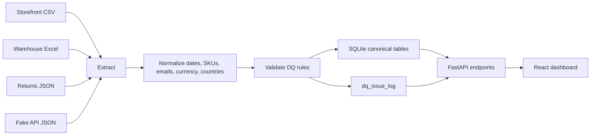

# Architecture

DataFlow Control Tower is split into three layers:

1. Ingestion and pipeline
2. FastAPI metrics service
3. React dashboard

## Data Flow

## Backend Modules

- `app/pipeline/extract.py`: reads CSV, Excel sheets, returns JSON, shipment API JSON, and support ticket API JSON.
- `app/pipeline/normalize.py`: standardizes SKUs, dates, currency, country codes, emails, and numeric values.
- `app/pipeline/validate.py`: applies data quality checks and returns clean rows plus issue logs.
- `app/pipeline/load.py`: writes dimensions, facts, DQ issue logs, and run logs to SQLite.
- `app/services/metrics_service.py`: turns canonical tables into dashboard-ready metrics.
- `app/api/routes.py`: exposes pipeline, metric, record, and AI-style summary endpoints.

## Canonical Tables

- `dim_customer`
- `dim_product`
- `dim_warehouse`
- `fact_order_line`
- `fact_return`
- `fact_shipment`
- `fact_inventory_snapshot`
- `dq_issue_log`
- `pipeline_run_log`

## Adaptability

The pipeline is built around normalized row dictionaries and rule ids rather than a single hardcoded UI scenario. To adapt this to another business, replace the raw files, update `dq_rules.yaml`, and adjust the extract/normalize layer while keeping the API and dashboard contracts stable.
